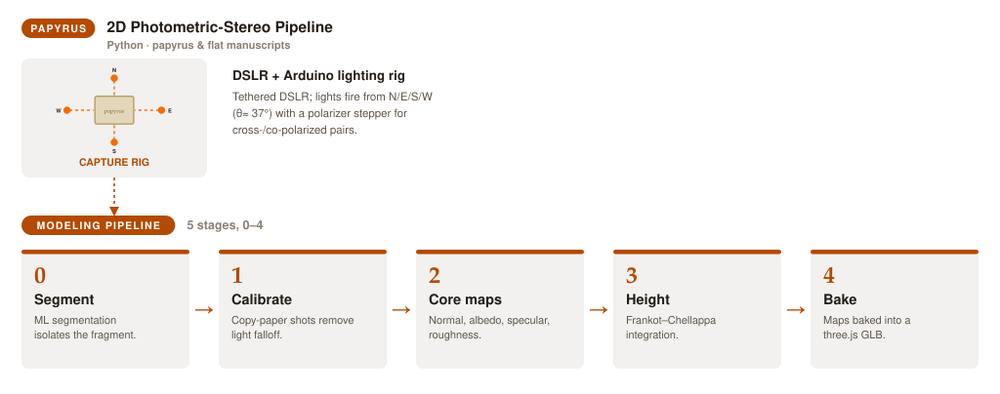

# 2D — Papyrus Pipeline

Photometric-stereo pipeline for flat manuscripts (papyrus, and any object that
needs fine surface detail but no real depth). A single Tkinter launcher ties the
sub-stages together. See the [repo setup guide](../SETUP.md) for first-time
install.

There are two builds of the launcher. Both are thin wrappers around one shared
app, `pipeline_app.py`, and differ only in how they drive the capture rig:

- **`run.py`** — Windows build (gphoto2 through msys2, serial port `COM3`).
- **`run_linux.py`** — Linux build (native gphoto2/dcraw on PATH, serial port
  `/dev/ttyACM0`). See [Linux](#linux) below.

Every step, the window layout and the dependency check live in
`pipeline_app.py`, so a change there reaches both builds. Only put
platform-specific code in `run.py` / `run_linux.py`.

## How it works



**How it runs day to day:**
- The launcher's controls are on the left, grouped and run top to bottom, with
  the log on the right. First pick a **working folder** (and tick "Scan both
  sides" for two-sided objects). Then:
  - **Setup:** Check / Install Dependencies, Open Focus Viewer.
  - **Calibration**, once per camera setup: 0a Capture Calibration (flat copy
    paper) → 0b Capture Colour Chart → 0c Fit Colour Matrix → 0d Lens
    Calibration.
  - **Artifact:** 1 Capture Scroll → 2 Run Modeling Pipeline → 3 Build 3D
    Model → 4 Generate Artifact Description.

  Calibration is stored beside the scan set (`<working>/cal/`, with the fitted
  matrix in `cal/ccm.json` and the lens fit in `cal/geo_calibration.json`), and
  the pipeline applies whatever is there automatically. Shoot 0a and 0b at the
  same exposure. Before modeling, the launcher lists any calibration the scan
  lacks and asks before running without it. It refuses to run with no
  flat-field at all, since modeling would fail.
- **Lens calibration (0d):** clicking 0d first shows a short guide. Photograph
  the 8 × 9-square, 45 mm checkerboard 10–30 times, at different positions and
  tilts covering the whole frame, with the same lens, zoom and focus as the
  scans. Then pick that folder. A folder with fewer than 5 photos is refused
  before anything runs. The fit is cached in the photo folder as
  `calibration.json` (delete it to re-fit). Modeling Stage 1b then removes lens
  distortion from the calibrated images and the alpha mask together. Without
  the file it skips that correction and says so in the log.
- **Colour fit environment (once per machine):** the fit needs contrib OpenCV,
  which clashes with the pipeline's OpenCV, so it has its own virtualenv,
  `.venv-colorfit` at the repo root. **Check / Install Dependencies** creates it
  (and repairs it if it is broken) using the Python the launcher runs on, which
  must be 3.9–3.12. Without it the pipeline still runs, just uncorrected.
- The **active working folder** holds one scan set; the pipeline reads it and
  writes `maps/` inside it from modeling plus `<folder>.glb` alongside it from
  rendering, so each scan set is self-contained and a fresh capture just starts
  its own timestamped folder inside the active folder.
- Ticking **"Scan both sides of the object"** shoots two scan sets (pausing
  for you to flip the object) into `side1/`/`side2/` subfolders, and modeling
  + rendering then run once per side. Leaving it unticked keeps the older
  single-scan-set behavior.
- **Two-sided alignment:** the sheet is flipped by hand between the two
  captures, so side2 lands at a different position and angle. After modeling,
  `backend/modeling/register_sides.py` aligns side2's maps to side1's outline,
  as seen from behind. That way the website's "Flip to other side" turns the
  sheet over in place. Step 2, Step 3 and Run Everything all do this
  automatically. It is skipped when already done and redone when side2 is
  re-modelled.
  - The originals are kept in `side2/maps/unregistered/`.
  - `side2/maps/registration_overlay.png` shows the match: red is side1, green
    is side2 and yellow is where they overlap. A good match is almost all
    yellow.
  - If the outlines overlap less than 80% the maps are left unchanged and the
    log says why. That usually means one side's alpha mask is wrong.
  - A nearly symmetric outline, such as a clean rectangle, can be matched the
    wrong way round, so check the overlay for those.
- The individual numbered steps always force a re-run; **"Run Everything"**
  instead skips any stage whose output already exists in that folder — handy
  for resuming after Stage 2 or 3 fails without redoing an earlier stage.
  Selecting a working image set only reports what the folder already has.
- Stage 0 (background removal) auto-detects the GPU: the run log prints
  `Device : CUDA` when `onnxruntime` reports a `CUDAExecutionProvider`, or
  `Device : CPU` otherwise — no config needed either way, only the installed
  wheels differ (see [GPU acceleration](#gpu-acceleration-optional--cuda--nvcc)
  below).

## Prerequisites

### Windows

- **OS: Windows** (the capture rig and launcher assume Windows paths/tools).
- **Python 3.9–3.12** with tkinter (install Python with the Tcl/Tk option, and
  tick "Add python.exe to PATH" in the installer). Get it from
  https://www.python.org/downloads/. Do **not** use 3.13/3.14 — the pinned
  `numpy<2.0` (and scipy/opencv/rembg) have no prebuilt wheels there and pip will
  try to compile numpy and fail.
- **Node.js LTS** on PATH — needed for the "Build 3D Model" (rendering) step.
  Get it from https://nodejs.org/ (tick "Add to PATH").
- **Capture-rig tools** (only if you run the hardware capture / focus viewer):
  - **msys2** with gphoto2 — https://www.msys2.org/ , then in the MSYS2 MINGW64
    shell: `pacman -S mingw-w64-x86_64-gphoto2`. Add the MSYS2 `mingw64\bin`
    folder to your PATH so `gphoto2` is callable from the launcher.
  - **dcraw** on PATH (converts the camera's RAW files → `.tiff`). Windows binary:
    https://sourceforge.net/app/dcraw/ (download `DCRaw_V9.28.exe` and put it on
    your PATH).
  - **Zadig** — camera USB driver swap, **required on Windows for gphoto2 to see
    the DSLR**. See [Camera driver setup (Zadig)](#camera-driver-setup-zadig-windows-only)
    below.

> **Putting tools on PATH:** several tools above must be on your PATH so the
> launcher (and MSYS2) can find them. If you're not sure how, follow this guide:
> https://www.howtogeek.com/787217/how-to-edit-environment-variables-on-windows-10-or-11/

#### Camera driver setup (Zadig, Windows only)

On Windows, `gphoto2`/libusb can't talk to the DSLR until the camera's USB
driver is replaced with **WinUSB** using [Zadig](https://zadig.akeo.ie/)
(download the standalone `.exe` — no install needed):

1. Connect the camera over USB and switch it **on** (put it in PC/PTP mode if it
   has one). Close any vendor software (e.g. EOS Utility) that may grab it.
2. Run Zadig, then **Options → List All Devices**.
3. In the dropdown, select your camera (e.g. "Canon Digital Camera" or "Nikon Digital Camera").
4. Set the target driver to **WinUSB** and click **Replace Driver**
   (or **Install Driver**).
5. Confirm with `gphoto2 --auto-detect` in the MSYS2 MINGW64 shell — the camera
   should now be listed.

> To go back to using the camera with its normal vendor software, uninstall the
> WinUSB driver from Windows Device Manager (or reinstall the vendor driver).

### Linux

- **Python 3.9–3.12** with tkinter — on Debian/Ubuntu:
  `sudo apt install python3-tk`. Do **not** use 3.13/3.14 (no prebuilt wheels
  for the pinned `numpy<2.0` and friends).
- **Node.js LTS** on PATH — needed for the "Build 3D Model" (rendering) step.
- **Capture-rig tools** (only if you run the hardware capture / focus viewer):
  - **gphoto2** and **dcraw** on PATH — `sudo apt install gphoto2 dcraw`
    (they are called directly, no msys2 needed).
  - Serial access to the Arduino: the scripts default to `/dev/ttyACM0`
    (override with the `PAPYRUS_SERIAL_PORT` env var). Add yourself to the
    `dialout` group for permission: `sudo usermod -a -G dialout $USER`, then
    log out and back in.

## Setup

The launcher sets up most dependencies itself. Launch it and click **Check /
Install Dependencies**. It checks, and installs or repairs where it can:

- **Python version.** It must be 3.9–3.12.
- **Python packages**, including their version pins: `numpy<2.0` and
  `rembg==2.0.65`. Missing or off-pin packages are fixed with
  `pip install -r backend/modeling/requirements.txt pyserial`.
- **OpenCV checkerboard detector**, used by Step 0d.
- **Background-removal model weights**, about 1 GB, downloaded once.
- **Colour-fit environment.** It creates or repairs `.venv-colorfit` (Step 0c)
  from `backend/modeling/requirements-colorfit.txt`.
- **Renderer.** Node.js must be 20.19 or newer for Vite. It runs
  `npm install` and installs Puppeteer's headless browser.
- **Capture rig:** gphoto2 (inside msys2 on Windows), dcraw, and the Arduino's
  serial port, including Linux `dialout` permission.
- **Calibration** present for the current working folder. This is reported but
  does not count toward readiness.

It ends with a per-area summary and one final line, either **READY** or **NOT
READY for: …**. A machine without the rig attached is expected to show
"NOT READY for: Capture" and can still model and build.

```bash
python run.py          # Windows
python3 run_linux.py   # Linux
```

The only things it can't install are Python itself, Node.js, gphoto2 (msys2 on
Windows), dcraw and the Zadig camera driver — see Prerequisites above. To install the Python deps manually instead, see
[`backend/modeling/README.md`](backend/modeling/README.md).

### GPU acceleration (optional — CUDA / `nvcc`)

Stage 0 of the modeling pipeline (background removal via `rembg`) runs on the CPU
by default. It transparently uses an NVIDIA GPU when one is available, which makes
mask generation several times faster — but that path needs the **CUDA toolkit**
(which provides `nvcc`) installed alongside a driver and cuDNN. This is entirely
optional; skip it to stay on CPU.

1. **NVIDIA driver + GPU.** Confirm the card is visible:

   ```bash
   nvidia-smi
   ```

2. **Install the CUDA toolkit (`nvcc`).** onnxruntime-gpu/torch need the matching
   CUDA runtime that the toolkit installs:

   - **Windows** — download the **CUDA Toolkit** installer from
     https://developer.nvidia.com/cuda-downloads (it installs `nvcc.exe` and adds
     it to PATH).
   - **Linux** — `sudo apt install nvidia-cuda-toolkit`, or NVIDIA's versioned
     `cuda-toolkit-12-x` package from the CUDA repo for a specific CUDA version.

   Verify the compiler is on PATH:

   ```bash
   nvcc --version
   ```

3. **Install cuDNN** for your CUDA version (required by `onnxruntime-gpu`):
   https://developer.nvidia.com/cudnn.

4. **Install the GPU Python wheels** in place of the CPU defaults — the GPU build
   of onnxruntime plus a CUDA build of torch (still honouring the `numpy<2.0`
   pin):

   ```bash
   pip install rembg[gpu] onnxruntime-gpu
   pip install torch --index-url https://download.pytorch.org/whl/cu121
   ```

   (Swap `cu121` for the CUDA version you installed above.)

The pipeline auto-detects the GPU: when `onnxruntime` reports a
`CUDAExecutionProvider` it prints `Device : CUDA`, otherwise it falls back to
`Device : CPU`. See
[`backend/modeling/README.md`](backend/modeling/README.md#gpu-acceleration).

## Usage

Run `python run.py` (Windows) or `python3 run_linux.py` (Linux) and click the
buttons top to bottom (select working image set → calibrate → capture → run
modeling → build model → describe). The active working folder holds one scan set
and receives all pipeline output, so each set is self-contained. The full flow
is documented in the module docstring at the top of `pipeline_app.py`. Finished
`.glb` files are published through the repo's `website/` (see
`website/artifacts/README.md`).

### Linux

The Linux build is `run_linux.py`. It is the same launcher as `run.py` (both
wrap `pipeline_app.py`) and runs the identical modeling and rendering stages; the
only difference is the capture scripts it invokes (`backend/capture/arduinoIntegration_linux.py` and
`focusViewer_linux.py`), which call gphoto2/dcraw natively and default to the
`/dev/ttyACM0` serial port:

```bash
python3 run_linux.py
```

## Structure

```
pipeline_app.py                       The launcher: UI, every step, dependency check (shared)
run.py                                Windows entry point (msys2 gphoto2, COM3, npm.cmd)
run_linux.py                          Linux entry point (native gphoto2/dcraw, /dev/ttyACM0)
backend/capture/                      DSLR + Arduino capture rig — see backend/capture/README.md
  arduinoIntegration.py               Windows capture loop (gphoto2 via msys2)
  arduinoIntegration_linux.py         Linux capture loop (native gphoto2)
  focusViewer.py / focusViewer_linux.py   Windows / Linux focus viewers
backend/modeling/                     Photometric-stereo pipeline — see backend/modeling/README.md
backend/rendering/                    Three.js / Vite GLB baker  — see backend/rendering/README.md
```
